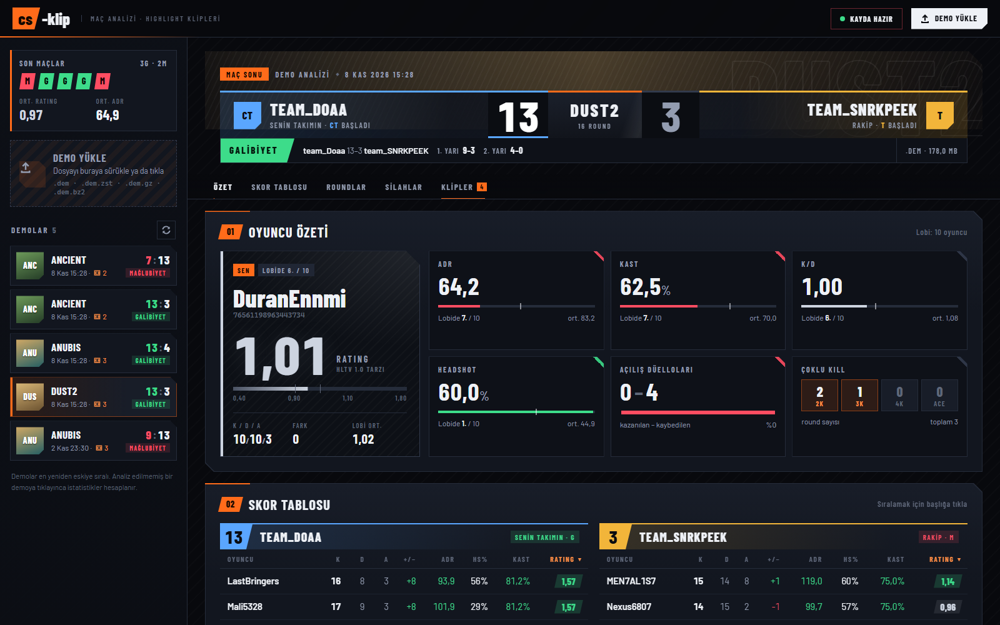
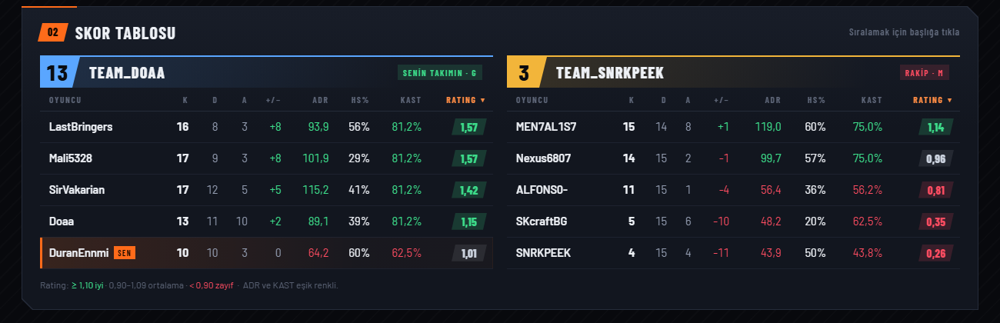
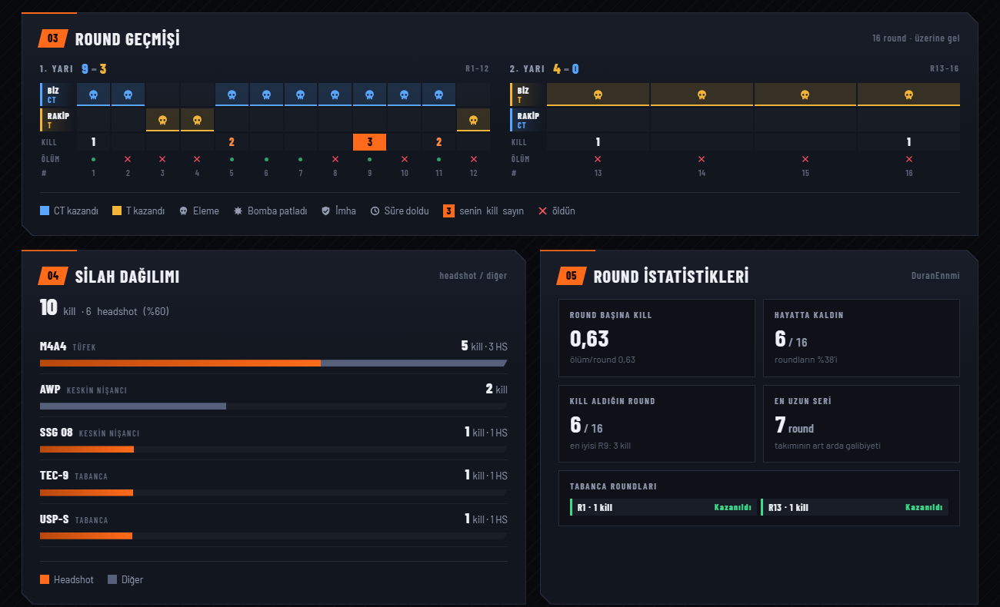
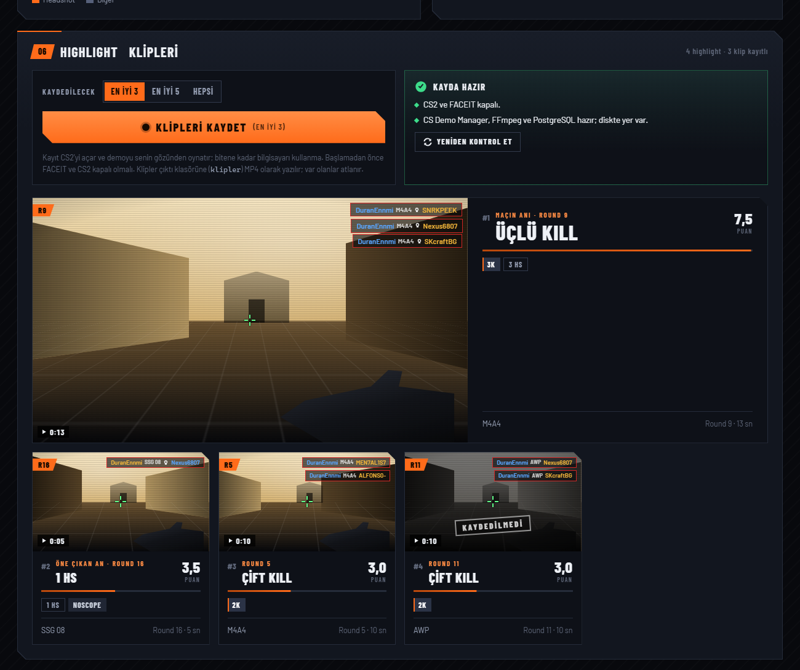

# cs-klip

[](https://github.com/rose-omer/cs-clip/actions/workflows/testler.yml)

CS2 maç demolarından senin en iyi anlarını bulan, puanlayan ve CS2'nin içinde otomatik `.mp4` klip olarak kaydeden
bir araç. Yanında Leetify benzeri yerel bir maç analizi arayüzü var: rating, ADR, KAST, skor tablosu, round geçmişi,
silah dağılımı ve kliplerin kendisi.



| Skor tablosu | Round ve silah analizi | Highlight klipleri |
|---|---|---|
|  |  |  |

## Nasıl çalışır

1. **Demoyu oku**: `.dem`, `.dem.zst`, `.gz`, `.bz2` açılır, [demoparser2](https://github.com/LaihoE/demoparser) ile
   kill'ler, round'lar ve oyuncu durumları çıkarılır.
2. **Puanla**: multi-kill, clutch, headshot, wallbang, noscope, smoke arkası gibi olaylar puanlanır, en iyi anlar seçilir.
3. **Kaydet**: [CS Demo Manager](https://cs-demo-manager.com/) demoyu CS2'de **bir kez** açıp anları kaydeder;
   parçalar FFmpeg ile birleştirilip `klipler/` klasörüne adlandırılır, sonunda montaj yapılır.
4. **Göster**: yerel arayüz maç istatistiklerini hesaplar ve klipleri sayfada oynatır.

Ayrıca: kayıt öncesi kontroller (FACEIT/CS2 açık mı, veritabanı, disk), takılan CS2 için süre sınırı, CS2'yi
çökerten bozuk demoları onaran bir yeniden yazıcı (`onarim.py`, ayrıntı [NOTLAR.md](NOTLAR.md)), tek tıkla kurulum
ve 150'den fazla test.

Gereken: Windows 10/11 ve CS2. Gerisini (Python, FFmpeg, PostgreSQL, CS Demo Manager) `kur.bat` kurar.
Bilinen sorunlar ve ölçümler: [NOTLAR.md](NOTLAR.md). İlk kayıt ve sorun giderme: [YAPILACAKLAR.md](YAPILACAKLAR.md).
`tasarimlar/` klasöründe arayüz için 10 farklı tasarım taslağı var (tek dosyalık HTML).

## Kurulum

1. Projeyi indir: `git clone https://github.com/rose-omer/cs-clip.git C:\cs-clip` (ya da GitHub → Code → Download ZIP).
   Yolda Türkçe karakter ve boşluk olmaması önerilir.
2. **`kur.bat`'a çift tıkla.** Oyuncu adını sorar (demodaki adın), sonra sırayla:

   | Adım | Ne yapar | Zaten varsa |
   |---|---|---|
   | Python | Python 3.11+ yoksa `winget install Python.Python.3.12` | atlanır |
   | `.venv` ve paketler | sanal ortam, `requirements.txt` | sürümler tutuyorsa atlanır |
   | `ayarlar.json` | `ayarlar.ornek.json`'dan, oyuncu adınla | dokunulmaz |
   | FFmpeg | `winget install Gyan.FFmpeg` | atlanır |
   | PostgreSQL 17 | `winget` ile yalnız programlar (hizmet kurulmaz; UAC sorarsa Evet). Olmazsa EDB zip'i `%LOCALAPPDATA%\csdm-pg\pgsql`'e açılır | atlanır |
   | CS Demo Manager | GitHub'daki son sürüm indirilir, özeti doğrulanıp sessiz kurulur | atlanır |
   | Veritabanı | `initdb --locale=C` ile `%LOCALAPPDATA%\csdm-pg\data` (Türkçe Windows'ta kurucunun `initdb` çökmesini aşar), rastgele şifre, 5432 doluysa sonraki port | atlanır |
   | Başlatma, `csdm` veritabanı | `pg_ctl start`, `createdb csdm` | atlanır |
   | CSDM ayarları | `%USERPROFILE%\.csdm\settings.json`: veritabanı bağlantısı + şifre, ffmpeg yolu; eksik alanlar şablondan. Değişirse eskisi `settings.json.yedek` | yalnız eksik/yanlış alanlar |
   | PATH | PostgreSQL `bin` kullanıcı PATH'ine (psql) | atlanır |
   | Testler | `pytest -q` | — |

   Son satırda `Kurulum tamam.` yazmalı. Bir adım olmazsa ne yapılacağı yazılır; düzeltip `kur.bat`'ı yeniden
   çalıştır, biten adımlar atlanır.
3. `klip.bat --kontrol` → `Her şey hazır`. Sonra `arayuz.bat`.

`kur.bat --prova` hiçbir şeyi değiştirmeden ne yapacağını gösterir. Diğer seçenekler: `--oyuncu AD` (sormadan),
`--test-yok`. PostgreSQL Windows hizmeti olarak kurulmaz: bilgisayar yeniden başlayınca kapalı kalır, `klip.bat` ve
arayüz kayıttan önce kendisi başlatır.

## Arayüz

`arayuz.bat` → tarayıcıda `http://127.0.0.1:8765/` açılır (yalnız bu bilgisayardan erişilir).

- Solda İndirilenler ve `demos/` klasöründeki demolar; sürükle-bırak ile demo yüklenebilir.
- Demo seçince maç istatistikleri: skor, rating, ADR, K/D/A, KAST, HS%, açılış kill'leri, iki takımın skor tablosu, round çizelgesi, silahlar.
- Derin analiz: harita üstünde kill/ölüm ısı haritası, utility (atılan bombalar, flaş asisti, kör süresi, bomba hasarı), nişan (isabet, sprey isabeti, kafa isabeti silaha göre, yaklaşık tepki süresi). Eski `.stats.json`'larda bu bölüm yoktur; sayfadaki "Yeniden hesapla" düğmesi ekler.
- Highlight listesi ve kaydedilmiş klipler sayfada oynatılır. "Klipleri kaydet" kaydı arka planda başlatır (FACEIT ve CS2 kapalı olmalı).
- Skor tablosunda bir oyuncuya tıklayınca onun highlight'ları listelenir; "Bu oyuncunun kliplerini kaydet" onun gözünden kaydeder.
  "Herkesin en iyi anı" maçtaki her oyuncunun en yüksek puanlı anını sıralar. "En iyi anlarım" vitrininde oyuncuya göre süzülür.
- İlk açılışta istatistik hesaplanır ve demonun yanına `.stats.json` olarak saklanır; sonraki açılışlar anında.
- **Ayarlar** sayfası (`#ayarlar`): oyuncu, en düşük puan, maç başına klip, klip öncesi/sonrası süre, temiz HUD,
  montaj, klip ve demo klasörleri, araç yolları. Değerler doğrulanıp `ayarlar.json`'a yazılır (`GET/POST /api/ayarlar`).
  Oyuncu ya da süreler değişince maçların analizi yeniden yapılır.
- "En iyi anlarım" → Montaj: **Sade** en iyi klipleri yeniden kodlamadan birleştirir; **Paylaşım** aşağıdaki
  paylaşım videosunu üretir (biçim, yerleşim, kart, etiket, kalite, boyut, müzik seçilebilir).

## Tam otomatik akış

`otomatik.bat` (= `python otomatik.py izle`) açık kaldıkça:

1. İndirilenler ve `demos/` (ya da `ayarlar.json` → `demo_klasorleri`) izlenir; indirmesi biten her **yeni** demo sıraya girer.
   İlk çalıştırmada klasörde zaten duran demolar sıraya girmez (`--mevcutlari-da` ile girer).
2. Sıradaki demo yalnız **CS2 ve FACEIT kapalıyken** kaydedilir: kapandıktan sonra `otomatik_bekle_sn` (120) beklenir,
   ön kontrol (`--kontrol` ile aynı) geçmezse beklenir. CS2 ya da FACEIT açıksa hiçbir şeye dokunulmaz.
   Aynı anda tek kayıt yapılır (arayüzle ortak `kayit.kilit`). Durum arayüzde soldaki "Otomatik kayıt" kutusunda.
3. FACEIT'ten indirme (isteğe bağlı): `ayarlar.json`'a `"faceit_api_anahtari"` (developers.faceit.com → App Studio →
   API Keys → Server side) ve gerekirse `"faceit_kullanici"` yaz.
   - `python otomatik.py faceit --adet 5`: son 5 maçın demosunu hemen indirip sıraya alır.
   - `otomatik.bat --faceit-dk 10`: 10 dakikada bir bakar, izleme başladıktan sonra biten maçları indirir.
   - Demo dosyasına erişim FACEIT'in **Downloads API** iznini isteyebilir; izin yoksa araç bunu açıkça söyler.

Diğer: `otomatik.py durum` (sırayı gösterir), `otomatik.py ekle <demo>` (elle sıraya ekler), `--temizle` (kaydı biten
demoyu Geri Dönüşüm Kutusu'na taşır), `arayuz.bat --otomatik` (izleyiciyi arayüzle aynı pencerede çalıştırır).

## Komutlar

| Komut | Ne yapar |
|---|---|
| `klip.bat <demo>` | Analiz + klip kaydı + montaj |
| `klip.bat <klasör>` | Klasördeki tüm demoları işler |
| `klip.bat <demo> --sadece-analiz` | Yalnız listeyi gösterir (CS2 gerekmez) |
| `klip.bat <demo> --prova` | Kaydetmeden çalışacak komutu ve klip adlarını gösterir |
| `klip.bat --kontrol` | Kayıt öncesi kontrol: araçlar, veritabanı, FACEIT/CS2 açık mı, disk |
| `--en-iyi N` | Maç başına yalnız en iyi N an |
| `--temizle` | Kaydı biten demoyu Geri Dönüşüm Kutusu'na taşır |
| `--oyuncu AD` | Başka oyuncunun anları (ad ya da SteamID64); klip adına `p-<ad>` eklenir: `anubis_59cf10f2_R05_p-Mert06_4K_ak47.mp4` |
| `--min-skor N` | Eşik (varsayılan 3) |

Demo dosyasını `klip.bat` üzerine sürükle-bırak da çalışır.

### Paylaşım videosu (LinkedIn / TikTok / Reels)

CS2 gerekmez, yalnız FFmpeg. Klipler değişmez; çıktı `klipler/paylasim/` altına yeni adla yazılır.

```
python paylas.py --dikey --en-iyi 5                     # en iyi 5 klip, 9:16, kart + etiket
python paylas.py --en-iyi 10 --kalite 1440p --hedef-mb 80
python paylas.py klipler\a.mp4 klipler\b.mp4 --dikey --yerlesim kirp --muzik parca.mp3
```

| Seçenek | Ne yapar |
|---|---|
| `--dikey` | 1080x1920 (1440p'de 1440x2560); yoksa yatay 1920x1080 / 2560x1440 |
| `--yerlesim bulanik\|kirp` | Dikeyde oyun görüntüsü bulanık arka planın ortasında ya da ortadan kırpılmış |
| `--kartsiz` | Baştaki 2,5 sn'lik kart olmasın (oyuncu, harita, skor, rating, ADR, K/D; `.stats.json` yoksa yalnız harita) |
| `--etiketsiz` | Kliplerde "4K · 1v3 CLUTCH" etiketi olmasın |
| `--muzik DOSYA` | Arka plan müziği; oyun sesi kısılır (`--oyun-ses 0.35`, `--muzik-ses 0.8`) |
| `--kalite 1080p\|1440p` | Çözünürlük |
| `--crf N` / `--hedef-mb N` | Kalite (varsayılan CRF 20) ya da yaklaşık dosya boyutu |
| `--prova` | Üretmeden ffmpeg komutunu ve filtreyi gösterir |

Arayüz API'si: `POST /api/en-iyi/montaj` gövdesine `dikey`, `yerlesim`, `kart`, `etiket`, `muzik`,
`oyun_ses`, `muzik_ses`, `kalite`, `crf`, `hedef_mb` (ya da `"paylasim": true`) eklenirse paylaşım videosu
üretilir; bu alanlar yoksa eski hızlı montaj. `GET /api/en-iyi` yanıtında `paylasim` listesi var.

Kayıt kalitesi `ayarlar.json`'da: `"kayit_cozunurluk": "1440p"` (ya da `"1080p"`), `"kayit_crf": 18`;
boş / 0 ise CSDM'in kendi ayarı kullanılır.

Kayıttan önce **FACEIT ve CS2 kapalı olmalı**. Araç bunları kapatmaz, yalnız söyler. Kapalı PostgreSQL'i kendisi başlatır.
Klibi hazır olan round atlanır; yarıda kalan iş aynı komutla sürdürülür. CS2'yi çökerten demo atlanır, sıradakine geçilir.
Başa sarınca CS2'yi çökerten demolar (ilk tam paketi bozuk, ör. bazı Ancient maçları) kayıttan önce kendiliğinden
onarılır (`<ad>.onarilmis.dem`) ve her parça ayrı CS2 açılışında kaydedilir; elle: `python onarim.py <demo.dem>`.

## Skorlama

| Olay | Puan |
|---|---|
| 1K / 2K / 3K / 4K / ACE | 1 / 3 / 6 / 10 / 16 |
| Kazanılan 1v2 / 1v3 / 1v4 / 1v5 clutch | +4 / +7 / +10 / +14 |
| Headshot (kill başı) | +0.5 |
| Wallbang, noscope, kör iken kill | +2 |
| Smoke arkası | +1.5 |
| Bıçak | +3 |
| 2 sn içinde art arda kill | +1 |

- Isınma ve maç öncesi bıçak kill'leri sayılmaz.
- Takım arkadaşı kill'i ve intihar sayılmaz.
- Kill'ler arasında 8 sn'den uzun boşluk varsa klip parçalara bölünür; parçalar birleştirilir.
- Klip ilk andan 3 sn önce başlar, son kill'den 2 sn sonra biter (`once_sn`, `sonra_sn`).

## Dosyalar

| Dosya | Görev |
|---|---|
| `klip.py` | Tek giriş noktası |
| `highlights.py` | Skorlama, clutch, klip parçaları |
| `analyze.py` | Demoyu okur (demoparser2) |
| `demofile.py` | Sıkıştırılmış demoyu açar, CS2 klasörünü bulur, Geri Dönüşüm Kutusu |
| `render.py` | CSDM ile kayıt, parçaları round'a atama, birleştirme, montaj |
| `kur.bat`, `kurulum.py` | Tek tıkla kurulum (`--prova`: değiştirmeden göster) |

| `paylas.py` | Paylaşım videosu: dikey/yatay, açılış kartı, kill etiketi, müzik, kalite |
| `kontrol.py` | Kayıt öncesi kontroller, PostgreSQL başlatma |
| `otomatik.py`, `otomatik.bat` | Klasör izleyici + kayıt kuyruğu (`otomatik.json`) |
| `faceit.py` | FACEIT Data API ile son maç demolarını indirme |
| `onarim.py` | Başa sarınca CS2'yi çökerten demoların ilk tam paketini onarır |
| `stats.py` | Maç istatistikleri (rating, ADR, KAST, round çizelgesi) |
| `arayuz.py`, `arayuz/` | Yerel web arayüzü: sunucu ve sayfa (`ayarlar.js`: Ayarlar sayfası) |
| `config.py` | `ayarlar.json` okur, doğrular, yazar |
| `araclar/` | Hız ölçüm ve deneme script'leri, CSDM ayar şablonu |
| `analiz_derin.py` | Isı haritası konumları, utility ve nişan metrikleri (`stats.json` içindeki `derin`) |
| `tasarimlar/` | Arayüz tasarım taslakları |
| `docs/` | Ekran görüntüleri |
| `test_*.py` | Testler: `.venv\Scripts\python -m pytest -q` |
